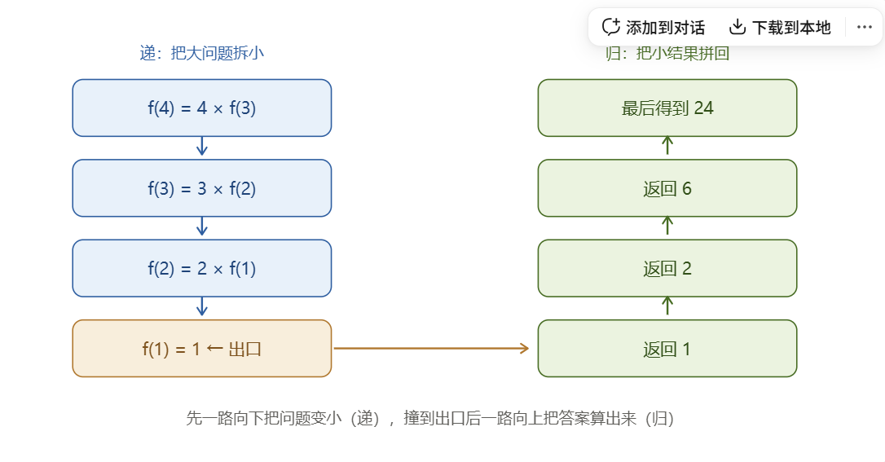
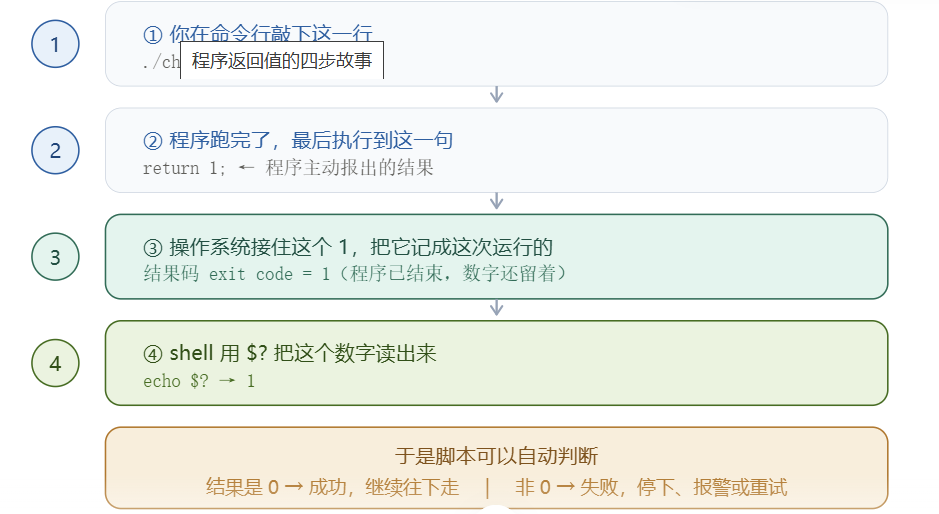
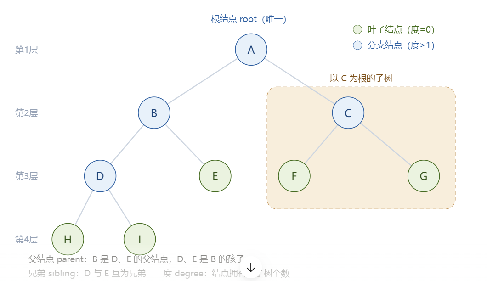
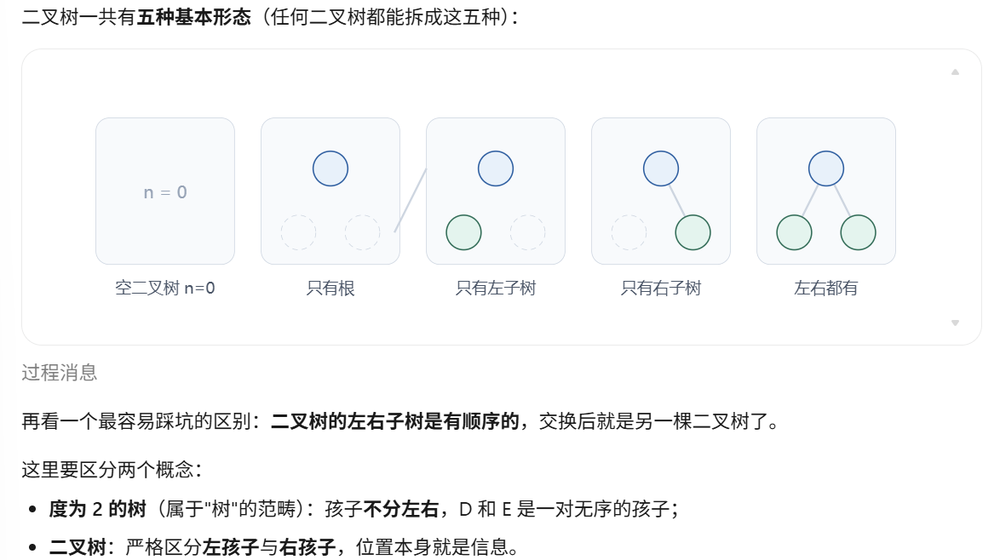

# 二叉树与递归

#### 树
一、什么是树
严格定义：
树（Tree）是 n（n ≥ 0）个结点的有限集合，满足：
当 n = 0 时，称为空树；
当 n > 0 时，
有且仅有一个特定的结点，称为根结点（root）​；
其余结点可以分成 m（m ≥ 0）个互不相交的有限集合 T₁, T₂, …, Tₘ，其中每一个集合本身又是一棵树，称为根的子树（subtree）​。

>这个定义里最关键的四个字是 “又是一棵树” ​ —— 定义自己用到了自己，这叫递归定义。**递归是树最本质的特征**，后面所有操作（遍历、求高度、释放内存）几乎都靠递归完成。
注意定义里的两个约束：
 “有且仅有一个根” ​（不能有两个根）
  “子树互不相交” ​（一个结点不能同时属于两棵子树，也就是不能有回路）。

## **SO什么是递归？**

递归（recursion）：在定义或函数内部，直接或间接地调用自己本身，但每次都处理一个规模更小的问题。​

它有两层含义：

1.递归定义：一个概念用它自己来定义。

* 阶乘：n! = n × (n−1)!，其中 1! = 1
* 二叉树：二叉树 = 空树，或者"一个根 + 两棵二叉树"
（树、二叉树定义，全都是递归定义。）

2.递归函数：C 语言里一个函数自己调用自己。

二、递归到底怎么"跑"起来
以阶乘为例，整个过程分成两个阶段： “递” ​（一路往下把问题变小）和 “归” ​（从出口一路往上传结果）。



递归函数三要素：
* 必须有出口（最小情况直接返回结果）
* 规模必须变小（每次调用都更靠近出口）
* 调用自己（用同一套逻辑处理子问题）
**！少了出口，或者规模没变小 → 无限递归 → 栈溢出 Stack Overflow**

>for example:
/* 递推关系：n! = n × (n-1)! */
int fact(int n)
 {
    if (n <= 1) return 1;      /* ① 出口：最小的情况，直接给出答案，不再调用自己 */
    return n * fact(n - 1);    /* ② 调用自己；③ 参数从 n 变成 n-1，规模确实变小了 */
}

#### 底层机制：函数调用栈
理解递归必须知道调用栈（call stack）​的存在：

每调用一次函数，系统就在栈上压入一个栈帧（stack frame）​，里面存放：本次调用的参数、局部变量、以及返回地址（本次调用结束后回到哪一行继续执行）。

**所以 递归深度 = 同时存在的栈帧个数，空间开销是 O(深度)。**

栈空间是有限的（一般几 MB），如果深度太深，栈帧压满 → 栈溢出（stack overflow）​，程序直接崩。

函数返回时栈帧被弹出，所以"归"的顺序恰好是"递"的顺序倒过来。

>这也解释了一条常被忽略的事实：函数自己调用自己，并不"神奇"，它就是普通调用，只是同一个函数被压了很多份。

**先进后出!!!**

向栈里加入一个新元素（入栈，push）
从栈中取出一个元素（出栈，pop）
所有元素都被弹出，栈就变成了空栈。此时如果继续出栈，程序就会报错（栈下溢）；
若不断向栈里加入元素，超过了它的最大容量，程序会报错（栈溢出）。

>递归如果没有结束条件就会一直往里递，但不会归，栈装不下了就会直接报错，也就是栈溢出。所以栈里只能放体积小生命周期短，和函数同生共死的临时数据。


#### 主函数返回值:
main 是程序的入口，它的返回值不像普通函数那样被另一个函数接收，而是交给操作系统，成为这个进程的退出状态码（exit status / return code）​。之后 shell、Makefile、CI 流水线、父进程都靠它判断"你这程序到底干成了没有"。
>**0 = 成功，非 0 = 失败。**
0 表示"没有任何错误编号"​。

四个容易记错的细节：

1.EXIT_SUCCESS 和 EXIT_FAILURE 定义在 <stdlib.h> 里，值是 0 和 1，写它比写裸数字更清楚。
2.C99 特例：main 函数如果走到结尾没写 return，编译器会自动补 return 0;。注意这个特权只有 main 有，普通函数不写返回值是未定义行为。
3.不要写 void main()。C 标准规定 main 必须返回 int。虽然很多编译器能过，但属于未定义行为、不可移植，考试写错也会扣分。
4.main 里 return 0; 和调用 exit(0); 效果基本等价 —— 都会结束程序、把值交给系统、刷新输出缓冲区。区别是 exit() 可以在任何函数里调用，而且会先执行 atexit() 注册的清理函数，return 只结束当前函数。


**退出码只有低 8 位有效**
return 0      -> shell 看到 0
return 1      -> shell 看到 1
return 2      -> shell 看到 2
return 255    -> shell 看到 255
return 256    -> shell 看到 0      ← 256 mod 256 = 0，shell 以为你成功了！
return 257    -> shell 看到 1
return 511    -> shell 看到 255
return -1     -> shell 看到 127    （Linux 下会是 255，负数各平台表现不一）
>所以别返回负数，也别返回超过 255 的值，用 0 ~ 125 这个范围最安全。

main返回值的作用：

返回值是写给程序看的，printf 是写给人看的 —— 两者用途完全不同。返回值最大的用途是让程序能被别的程序自动判断成败：
1.shell 串联：./download && ./unzip && ./build，前一步失败（返回非 0），后面的自动不跑；
2.条件判断：if ./check_data; then echo "数据可用"; fi；
3.Makefile：每条编译命令返回非 0，make 立刻停下并报错，这就是它知道你编译失败的方式；
4.CI / 自动化测试：测试不通过就 return 1，流水线变红 —— 这是每个工程师每天都在用的机制。



* $? 不是程序的一部分，是 shell 自己的一个变量，专门存"上一条命令的结果码"。注意它会被下一条命令覆盖，所以要马上用。
* && 是最常用的形式，读作"​并且…的前提是前面成功"。
* if 是同一个道理的正式写法，还能配 else。

**check.c：参数是偶数就 return 0，是奇数就 return 1**
 >情况 1：传送偶数 4 （程序内部会 return 0）
check: 4 是偶数，检查通过
【shell 拿到】$? = 0
【shell 判断】0 -> 成功 -> 继续干后面的活


 >情况 2：传送奇数 7 （程序内部会 return 1）
check: 7 是奇数，检查不通过
【shell 拿到】$? = 1
【shell 判断】非 0 -> 失败 -> 停下报警


同一个程序，只是参数不同，shell 就自动走了完全不同的分支 —— 这就是 return 值的全部意义。
**&& 的效果更直观：**

>--- 先跑 check 4（成功），再跑 check 8 ---
check: 4 是偶数，检查通过
check: 8 是偶数，检查通过      ← check 8 真的执行了
两条都成功了，才轮到我说话

>--- 先跑 check 3（失败），再跑 check 8 ---
check: 3 是奇数，检查不通过
（注意：上面 check 8 根本就没被执行，因为前面那条失败了）


>int main(int argc, char *argv[])
{
    if (argc < 2) {                    /* 参数不够 */
        fprintf(stderr, "用法：%s 参数...\n", argv[0]);
        return 2;                      /* 告诉调用者：是你用法错了 */
    }
    /* ... 真正干活的代码 ... */
    if (出了点问题) return 3;           /* 告诉调用者：数据不对 */
    return 0;                          /* 告诉调用者：办成了 */
}



二叉树定义：
二叉树是 n（n ≥ 0）个结点的有限集合，它或者是空树（n = 0），或者由一个根结点加上两棵互不相交的、分别称为根的左子树和右子树的二叉树组成。

对比树和二叉树的定义，能看出两条差别：
每个结点最多两个孩子，而且通常直接把它们固定命名为 left 和 right；
左右是有区别的（有序）​，不能随意交换 —— 这是二叉树的核心特征。




### 二叉树在 C 语言中怎么存
有两种思路：
链式存储（指针，主流）和顺序存储（数组，专门对付完全二叉树）。

四种遍历：
前序（根→左→右）、中序（左→根→右）、后序（左→右→根）、层序（用队列按层走）。​已知"前序 + 中序"或"后序 + 中序"可以唯一确定一棵二叉树，但"前序 + 后序"不行。

* 二叉搜索树 BST：左子树全小于根，右子树全大于根，查找 O(log n)（平衡时）。
* 堆：完全二叉树 + 数组存储，tree[i] 与 2i+1 / 2i+2 的父子关系，实现 O(log n) 的插入和取最值。
* 哈夫曼树：带权路径长度最小的二叉树，用于压缩编码。
平衡树（AVL / 红黑树）​：专门解决"斜树退化成链表、高度变 O(n)"的问题，把高度锁在 O(log n)。
* 递归思维：把上面的代码再读一遍，你会发现几乎每个函数都是 if (root == NULL) return; 处理根; 递归左; 递归右; —— 掌握"空树是出口，子树是同类问题"这两句话，就掌握了二叉树编程的全部套路


**链式存储（二叉链表）**

>/* 二叉树结点的标准定义 —— */
typedef struct TreeNode {
    int              data;    /* 数据域：存你要放的值 */
    struct TreeNode *left;    /* 左孩子，没有就是 NULL */
    struct TreeNode *right;   /* 右孩子，没有就是 NULL */
} TreeNode, *BiTree;          /* BiTree 就是 struct TreeNode * */


**question**:
#### 函数的入口和出口
| 术语 | 大白话 | 在代码里对应什么 |
|---|---|---|
| **入口（Entry）** | 从哪**进**函数 | 函数体 `{` 之后的第一行 |
| **出口（Exit）** | 从哪**出**函数 | `return` 语句 / 函数体 `}` |

>int add(int a, int b) {     // ← 这一行是"门牌号"（函数名+参数）
    int c = a + b;          // ← 【入口】从这里开始执行
    return c;               // ← 【出口1】执行到这里，带着 c 回去
}                           // ← 【出口2】万一没 return，走到这就出去了

     main 里调用 add(3,5)
            │
            ↓
    ┌───────────────────┐
    │  int add(int a, int b)  ← 参数 a=3, b=5 送进来了（入口）
    │  int c = a + b;         ← 入口后第一件事
    │  return c;              ← 出口：带着 8 返回调用处
    └───────────────────┘
            │
            ↓
    回到 main，继续往下执行

| | 说明 |
|---|---|
| **入口只有 1 个** | 一个函数**只有一个**开始执行的起点（就是函数体开头），不存在从中间某行开始跑的 |
| **出口可以有多个** | 一个函数里可以写**好几个 `return`**，每个都是一个"逃生门" |


>int find_max(int a, int b) {
    if (a > b) {
        return a;      // 出口1
    }
    return b;          // 出口2
}
int f() {
    return 1;
    printf("这行永远不会执行");   // ❌ 死代码，永远到不了
}

| 写法 | 出口行为 |
|---|---|
| `return c;` | **带值出**（返回值给调用者） |
| `return ;` | **空手出**（只结束，不返回值，用于 `void` 函数） |
| 走到 `}` | **兜底出门**（没写 return 时，函数体结束自动出） |

把程序想成一条长长的路：main 走 → 遇到 add() → 拐进 add 的门（入口）→ 在里面走 → 从 return 出门（出口）→ 回到 main 继续走函数调用就像一个"岔路"：进去绕一圈，从出口回到原地，接着往下。这也解释了递归（自己调自己）：一个函数不断从自己入口进去、出口出来，一层套一层。


#### 和"栈"的关系：
调用 add(3,5)
  ↓
栈上压入一个新格子（存 a、b、局部变量 c）
  ↓
【入口】开始执行
  ↓
【出口】return 时
  ↓
栈上这个格子弹出（a、b、c 全部销毁）
  ↓
回到 main


这是进阶但很关键的一环 —— 每次函数调用，都会在栈上开一块"活动记录"：所以局部变量会"随函数结束而消失" —— 因为那块栈内存属于这个函数的"活动记录"，出口一出去，记录就销毁了。这正是你之前学的"局部变量生命周期 = 函数执行期间"的根本原因。

### 树和空指针

 一、树为什么离不开空指针

树 = **结点 + 指针** 串起来的结构（和链表一脉相承）。**每个"没有孩子"的位置，指针就指向 `NULL`** —— 这是树能"把形状画出来"的关键。

```c
struct TreeNode {
    int data;
    struct TreeNode *left;    // 左孩子
    struct TreeNode *right;   // 右孩子
};
```

| 情况 | 指针值 |
|---|---|
| 有左孩子 | 指向那个结点 |
| **没有左孩子** | `left = NULL` |
| 有右孩子 | 指向那个结点 |
| **没有右孩子** | `right = NULL` |


 二、NULL 在树里的三重身份

**身份 1：边界线 —— 告诉程序"到此为止"**

```c
        A
      /   \
     B     C        ← C 是叶子
    / \
   D   E
```

- `D.left = NULL`、`D.right = NULL`（D 没孩子）
- `E.left = NULL`、`E.right = NULL`
- `C.left = NULL`、`C.right = NULL`

**这些 NULL 就是树的"终点标记"** —— 没有它们，程序不知道怎么停。

**身份 2：遍历的刹车**

树的递归遍历，**停止条件就是 `if (root == NULL) return;`**：

```c
void preorder(struct TreeNode *root) {
    if (root == NULL) return;   // ← 碰到 NULL 就返回，这就是刹车
    printf("%d ", root->data);
    preorder(root->left);
    preorder(root->right);
}
```

**没有这句 NULL 判断，递归会无限往下跑，直接栈溢出崩溃。**

**身份 3：判断"叶子/空树"的依据**

```c
if (root == NULL) { ... }                       // 空树
if (root->left == NULL && root->right == NULL) { ... }   // 叶子结点
```


**题目**：建一棵这样的树

```
      1
     / \
    2   3
   / \
  4   5
```

**代码**：

```c
struct TreeNode n4 = {4, NULL, NULL};   // 叶子：两个孩子都是 NULL
struct TreeNode n5 = {5, NULL, NULL};   // 叶子
struct TreeNode n2 = {2, &n4, &n5};     // 2 的孩子是 4、5
struct TreeNode n3 = {3, NULL, NULL};   // 叶子
struct TreeNode n1 = {1, &n2, &n3};     // 根
```

规律：
- 叶子结点 = 两个指针都是 NULL
- 分支结点 = 指针指向子结点
- 整棵树 = 从 root（这里是 n1）出发，靠指针一路找下去

**从 n1 出发，能到哪些结点？**
```
n1 → n2 → n4
n1 → n2 → n5
n1 → n3 → NULL
```
**树是"单向可达"的** —— 从根能到所有结点，但没有指针能从孩子指回父亲。


树的空指针 vs 链表的空指针


| | 链表 | 二叉树 |
|---|---|---|
| 指针数量 | 每个结点了 **1 个** `next` | 每个结点了 **2 个** `left/right` |
| 结尾标记 | 最后一个结点 `next = NULL` | 叶子结点 `left = right = NULL` |
| 遍历 | `while (p != NULL) p = p->next` | 递归，碰到 NULL 就返回 |
| 本质 | **指针 + NULL 划边界** | **指针 + NULL 划边界** |

**学会链表，树就通了一半** —— 都是"结点 + 指针 + NULL 收尾"这一套。


**最常见的两个坑**

坑 1：访问空指针的子结点（段错误杀手）

```c
if (root->left->data == 5)   // ❌ 如果 root->left 是 NULL，直接崩
```

正确写法 —— 先判空，再取值：

```c
if (root->left != NULL && root->left->data == 5) { ... }   // ✅
```

> `&&` 是**短路**的：左边 false 了，右边根本不执行，所以不会崩。

坑 2：malloc 出来的结点，指针没置 NULL**

```c
struct TreeNode *p = malloc(sizeof(struct TreeNode));
p->data = 10;
// ❌ 忘了 p->left = NULL; p->right = NULL;
// 结果 left/right 是垃圾值，遍历时会跑到随机地址 → 崩溃
```

正确做法 —— 新结点必须把指针清零：

```c
p->left = NULL;
p->right = NULL;
```

**总结**

> 树的形状，靠指针画出来；树的边界，靠 NULL 标出来。
> 每个没有孩子的位置，指针必须是 NULL；每次递归，必须判 NULL 收手；每次新建结点，必须主动把指针置 NULL。


##### 二叉树的三种遍历代码：
struct TreeNode {
    int data;
    struct TreeNode *left;
    struct TreeNode *right;
};

>// 前序：根 → 左 → 右
void preorder(struct TreeNode *root) {
    if (root == NULL) return;      // ← 刹车（NULL 就收手）
    printf("%d ", root->data);     // ← 访问根
    preorder(root->left);          // ← 递归左子树
    preorder(root->right);         // ← 递归右子树
}

>// 中序：左 → 根 → 右
void inorder(struct TreeNode *root) {
    if (root == NULL) return;
    inorder(root->left);           // ← 先左
    printf("%d ", root->data);     // ← 再根
    inorder(root->right);          // ← 后右
}

>// 后序：左 → 右 → 根
void postorder(struct TreeNode *root) {
    if (root == NULL) return;
    postorder(root->left);         // ← 先左
    postorder(root->right);        // ← 再右
    printf("%d ", root->data);     // ← 最后根
}


顺序存储（数组）【只给完全二叉树用】

* 完全二叉树：按层序给结点编号，编号与同深度满二叉树完全对应。通俗说，就是把满二叉树最右边（最下层的右侧）连续去掉若干个结点。它允许度为 1 的结点，但最多只能有一个。

>#define MAXN  100
int tree[MAXN];   /* tree[0] 就是根；约定用 0 表示"这个位置没有结点" */
/* 有了下标，父子关系直接算，一个指针都不用存 */
int leftIdx  = 2 * i + 1;
int rightIdx = 2 * i + 2;
int parentIdx = (i - 1) / 2;      /* 整数除法，自动向下取整 */

| 坑 | 后果 | 正确做法 |
| --- | --- | --- |
| 写成 `TreeNode *left;`（没带 `struct`） | 编译直接报错：unknown type | 必须写 `struct TreeNode *left;` |
| `malloc` 后忘了 `free` | 内存泄漏 | 写 `destroyTree`，后序释放 |
| 释放顺序写成"先 free 自己" | 孩子指针丢了，整棵子树泄漏 | 先 `free` 孩子，最后 `free` 自己 |
| `free(root)` 后立刻又用 `root` | 野指针，随机崩溃 | `free(root); root = NULL;` |
| 数组存非完全二叉树 | 空间浪费按 2 的幂爆炸 | 非完全二叉树一律用链表 |

三叉链表
typedef struct PNode {
    int            data;
    struct PNode  *left;
    struct PNode  *right;
    struct PNode  *parent;     /* 多出来的这一根 */
} PNode;

a->left = b;      ← 父指向子
b->parent = a;    ← 子指向父（这行最容易忘！）

### 链二叉树
链式二叉树 = data + left + right 三个字段；建树可以用"前序序列 + # 占位"递归完成；遍历、统计、变形、复制、判等、释放全都是同一份递归骨架，区别只在于"空树返回什么、对根做什么、怎么合并左右的结果"。

>返回值 函数(BiTree root) 
{
    if (root == NULL) return 出口值;     /* ① 空树出口：永远第一行 */
    对 root 本身做点什么;                 /* ② 用 root->data */
    左边结果 = 函数(root->left);          /* ③ 递归左子树 */
    右边结果 = 函数(root->right);         /* ④ 递归右子树 */
    return 把 ① ② ③ ④ 拼起来;            /* ⑤ 合并并返回 */
}

| 操作 | ① 空树返回 | ② 对根做什么 | ⑤ 返回什么 |
| --- | --- | --- | --- |
| 前序遍历 | `return` | `printf` 打印根 | 无（void） |
| 求结点数 | `0` | 什么都不做 | `1 + 左 + 右` |
| 求叶子数 | `0` | 判断是否叶子 | 叶子返回 1，否则 `左 + 右` |
| 求高度 | `0` | 什么都不做 | `max(左, 右) + 1` |
| 复制树 | `NULL` | `newNode(root->data)` | 把左右挂到新结点上 |
| 判等 | 都空返回 1 | 比较 `data` | `左相同 && 右相同` |
| 交换左右 | `return` | 交换 left / right | 无（void） |
| 释放整树 | `return` | 什么都不做 | 先递归左右，最后 `free(root)` |

建树
>/* 方式 1：手工搭 —— 结点少、结构固定时最直观 */
BiTree root = newNode('A');
root->left  = newNode('B');
root->right = newNode('C');
root->left->right = newNode('D');

>/* 方式 2：按前序序列递归建 —— 从输入/文件批量建树的标准做法 */
static const char *g_seq;   /* 待解析的前序序列 */
static int         g_pos;   /* 当前读到第几个字符 */
static BiTree buildRec(void)
{
    char c = g_seq[g_pos];
    if (c == '\0') return NULL;      /* 序列读完 */
    g_pos++;                         /* 吃掉当前字符 */
    if (c == '#') return NULL;       /* '#' 代表空子树 */
    TreeNode *root = newNode(c);     /* 先建根 */
    root->left  = buildRec();        /* 再递归建左子树 */
    root->right = buildRec();        /* 再递归建右子树 */
    return root;
}

变形操作：交换左右子树

>void swapChildren(BiTree root)
{
    if (root == NULL) return;                 /* 出口 */
    TreeNode *tmp = root->left;               /* 交换自己的两个孩子 */
    root->left    = root->right;
    root->right   = tmp;
    swapChildren(root->left);                 /* 左子树内部也要换 */
    swapChildren(root->right);                /* 右子树内部也要换 */
}
